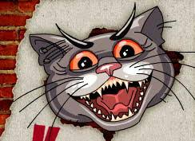

# Кот Депресняк

<p align="center"></p>

Настольный питомец «Кот Депресняк» **3.0** (2007, по мотивам «Мефодия Буслаева») — порт на современную Windows.

Оригинальная программа была Flash-роликом, завёрнутым в MDM Zinc 2.5 и упакованным Thinstall.
На Windows 10/11 она не запускается: загрузчик Thinstall 2006 года падает в `ntdll`, а Defender
ложно определяет его как троян. В этом порте используется **тот же самый ролик** (вся анимация,
звук и скрипты из оригинала). Его проигрывает [Ruffle](https://ruffle.rs) в прозрачном окне
[Tauri](https://tauri.app) (системный WebView2), поэтому программа весит около 13 МБ.

## Что умеет

Всё как в оригинале:

- прозрачное окно поверх всех окон, клики по пустым местам проходят насквозь;
- левая кнопка мыши — перетащить кота, правая — меню кота;
- меню: **Летать**, **Кататься** (сноуборд), **Спать** (ложится → спит → встаёт), **Сидеть**
  (20 фраз в облачке по кругу), **Питаться**, **Туалет**, **Рокер** (мотоцикл), **Любовь**, ссылки «Домой» / «В гости к Мефу»,
  «О программе», «Свернуть» (в трей), «Закрыть»;
- при запуске — вылупление из яйца;
- Esc закрывает программу.

Дополнительно, в меню значка в трее: размер кота, «поверх всех окон», отключение звука,
возврат в центр экрана и автозапуск с Windows. Позиция и настройки запоминаются.

### Анимации в ролике

| Метка | Кадры | Что происходит |
|---|---|---|
| `start` | 1–435 | вылупляется из яйца |
| `fly` | 436–870 | летает (с рогаткой) |
| `snow` | 871–1459 | катается на сноуборде |
| `lech` / `son` / `vstaet` | 1460–1572 | ложится, спит, встаёт |
| `phr1` … `phr20` | 1573–8212 | 20 фраз в облачке |
| `est` | 8213–9367 | ест |
| `kakat` | 9368–9590 | туалет |
| `rocker` | 9591–10619 | надевает косуху и уезжает на мотоцикле |
| `sex` | 10620–11757 | «Любовь» |

Без пункта меню кот сам проходит все сцены по кругу: fly → snow → est → kakat → rocker → sex →
lech → son → vstaet → fly … В ролике нет неиспользуемых клипов, фигур или звуков: все 1024
определения где-то размещены, и каждый участок временной шкалы достижим из скриптов.

Версия 2.4 (без «Рокера» и «Любви») лежит в `assets-src/cat_v2.4.swf`.

Исправлена ошибка оригинала: у фразы №16 не было метки `phr16`, поэтому когда случайный выбор
выпадал на 16, кот замирал. Метка добавляется при сборке (`tools/patch_swf.py`).

## Скачать

Готовые сборки лежат в [Releases](https://github.com/proteus1121/depresnyak/releases/latest):

- `Depresnyak-<версия>-portable.exe` — один файл (~13 МБ), запускается без установки;
- `Depresnyak-<версия>-setup.exe` — установщик (ярлык в меню «Пуск», удаление через «Приложения»).

Нужен WebView2 — он уже есть в Windows 10/11. Сборки не подписаны, поэтому при первом запуске
SmartScreen может предупредить: «Подробнее» → «Выполнить в любом случае».

## Сборка из исходников

Нужны Node.js 22, [Rust](https://rustup.rs) и Visual Studio Build Tools (C++).

```sh
npm install
npm start      # запустить в режиме разработки
npm run dist   # собрать src-tauri/target/release/depresnyak.exe и установщик в .../bundle/nsis/
```

Новый релиз: поставить тег `vX.Y.Z` и запушить его (`git tag v3.1.1 && git push origin v3.1.1`).
GitHub Actions (`.github/workflows/release.yml`) соберёт exe и установщик и выложит их в релиз.
Workflow можно запустить и вручную: Actions → Release → Run workflow.

## Как устроено

- `src-tauri/src/main.rs` — окно (прозрачное, без рамки, поверх всех), трей, настройки,
  команды ролика (`mdm.*`), диалог «О программе», автозапуск, системный Arial для Ruffle.
- `ui/` — страница с Ruffle: `config.js` (настройки Ruffle), `renderer.js` (меню кота,
  перетаскивание, `fscommand`, клики сквозь пустые места), `assets/cat.swf`.
- `ui/assets/cat.swf` — оригинальный ролик с правками (см. `tools/patch_swf.py`):
  - заглушка `_global.mdm`: вызовы Zinc API (`mdm.Application.exit/minimize`,
    `mdm.Dialogs.prompt`) превращаются в `fscommand`, которые обрабатывает приложение;
  - колбэк `catHit(x, y)` = `_root.hitTest(x, y, true)` через `ExternalInterface`:
    страница спрашивает у ролика, есть ли под курсором кот, и если нет — окно пропускает
    клики к окнам под ним (как прозрачное окно Zinc);
  - недостающая метка `phr16`.
- Фразы набраны системным шрифтом «Arial CYR», вместо него берётся Arial из `C:\Windows\Fonts`.
- `ui/selftest.js` — самотест без мыши (`CAT_SELFTEST=<пункт меню>`, `CAT_SELFTEST_LOG=<файл>`).

### Как ролик был извлечён из cat.exe

`tools/extract_zinc.py cat.exe cat_original.swf` повторяет то, что делал Zinc при запуске:

1. В конце exe лежат zlib-потоки Zinc: XML проекта, каталог (`swfdata0`, `swfdatar0`) и данные.
2. `swfdata0` = base64(Blowfish-CFB8(первые 200 000 байт SWF)), `swfdatar0` = остаток SWF как есть.
3. Ключ (библиотека DCPcrypt): `SHA1(swfpath + title)` = `SHA1("E:\work\yess\cat\cat.swfCat")`,
   IV = Blowfish-ECB(ключ, 8 нулевых байт).

Результат — `assets-src/cat_original.swf` (CWS v7, 920×750, 24 к/с, 11757 кадров, 65 звуков).

## Авторские права

Персонаж и ролик «Кот Депресняк» принадлежат их авторам (проект «Мефодий Буслаев»,
www.buslaev.ru). Программа распространялась бесплатно. Ruffle — MIT / Apache-2.0.
